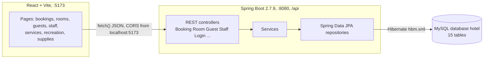
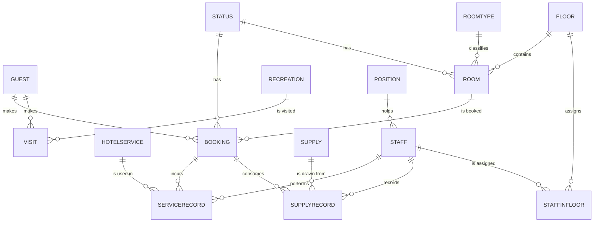

# Poseidon Resort

A hotel management system for a small resort: guests register, log in and reserve rooms or book recreation time, while front-desk and back-office staff handle check-in/out, room status, staff rosters, supplies and service records.

Stack: React 18 + Vite 4 (MUI, react-router) client, Spring Boot 2.7.9 REST API on Java 11 (Spring Data JPA, Hibernate `hbm.xml` mappings), MySQL/MariaDB.

## What it does

| Feature | Who uses it | Where in code |
|---|---|---|
| Register / log in as a guest | Guests | `LoginController`, `GuestController`; `pages/Login.jsx`, `pages/Register.jsx` |
| Reserve a room online, or walk-in booking at the counter | Guests / front desk | `BookingController`; `pages/bookingPage/*` |
| Check-in, check-out, extend stay, payment summary | Front desk | `BookingController` (`chkin`, `chkout`, `diffday`); `paymentBooking.jsx` |
| Room inventory by floor, type and status | Front desk | `RoomController`, `FloorController`, `RoomTypeController`; `pages/roomPage/*` |
| Hotel services (spa, laundry...) and per-booking service records | Guests / staff | `HotelServiceController`, `RecordHotelServiceController`; `pages/hotelServicePage`, `pages/recordServicePage` |
| Recreation facilities and guest visits | Guests / staff | `RecreationController`, `VisitController`; `pages/recreationPage`, `pages/visitPage` |
| Staff directory, positions, floor assignments | Management | `StaffController`, `StaffinfloorController`, `PositionController`; `pages/staffPage`, `pages/staffInFloorPage` |
| Supplies stock and usage records | Housekeeping | `SupplyController`, `SupplyRecordController`; `pages/supplyPage`, `pages/supplyrecordPage` |

## Architecture



A booking starts in the client: `createBookingByGuest.jsx` lists vacant rooms (`GET /api/rooms/status/1`) and posts the chosen room and dates to `POST /api/bookings/guest`. `BookingController` builds a `Booking` for the guest held in the static `GuestLogin.guestLogin`, sets booking status 5 ("booked"), saves it through `BookingService` -> `BookingRepository`, then flips the room's status to 2 ("reserved") via `RoomService`. On arrival the desk calls `PUT /api/bookings/chkin/{bid}`, which stamps `chkin`, moves the booking to status 6 and the room to 3 ("occupied"); `PUT /api/bookings/chkout/{bid}` stamps `chkout`, sets status 7 and frees the room (status 1). `paymentBooking.jsx` uses `GET /api/bookings/diffday/{id}` for the number of nights.

## Repository layout

```
Web-Service-API/
├── hotel.sql                      # phpMyAdmin dump: schema + seed data for database `hotel`
├── Poseidon_Resort/               # Spring Boot API (Maven, WAR packaging)
│   ├── pom.xml                    # Boot 2.7.9, Java 11, web + data-jpa + mysql-connector 8.0.32
│   ├── mvnw, mvnw.cmd, .mvn/      # Maven wrapper (3.8.7)
│   ├── bin/                       # Eclipse output folder committed by accident (copies of mvnw/pom)
│   └── src/main/
│       ├── java/*.hbm.xml         # Hibernate XML mappings, one per table
│       ├── java/th/ac/ku/kps/eng/cpe/se/
│       │   ├── Poseidon_Resort/   # PoseidonResortApplication, ServletInitializer
│       │   ├── restservice/       # 17 @RestController classes under /api
│       │   ├── service/           # thin @Service layer
│       │   ├── repository/        # Spring Data CrudRepository interfaces
│       │   └── model/             # entities (Booking, Room, Guest, Staff, ...)
│       ├── java/th/ac/ku/kps/eng/cpe/soa/   # LoginDTO, GuestLogin, Login/RegisterResponse
│       └── resources/application.properties # port, datasource, hbm list
└── soa_posidon_React/             # Vite + React client
    ├── vite.config.js             # default config (dev server on 5173)
    └── src/
        ├── App.jsx                # all routes (react-router-dom v6)
        ├── pages/                 # Login, Register, Home + one folder per resource
        └── styles/
```

## Run locally

Prerequisites: Java 11, Maven (wrapper included), Node.js with npm (Vite 4 needs Node 14.18 or newer), MySQL or MariaDB on `localhost:3306`.

```bash
mysql -u root -p -e "CREATE DATABASE hotel"
mysql -u root -p hotel < hotel.sql
# edit Poseidon_Resort/src/main/resources/application.properties: spring.datasource.username / spring.datasource.password
cd Poseidon_Resort && ./mvnw spring-boot:run          # API on http://localhost:8080/api
cd ../soa_posidon_React && npm install && npm run dev  # client on http://localhost:5173
```

The API URL `http://localhost:8080` is hard-coded in each page's `fetch()` call, and CORS is pinned to `http://localhost:5173` via `@CrossOrigin` on every controller, so keep both ports as they are.

## API

All paths are prefixed with `/api`. Request and response bodies are the JPA entities as JSON.

| Method | Path | Purpose |
|---|---|---|
| POST | `/login` | Guest login (`{username, password}`); returns `{status, msg, guest}` |
| POST | `/guests` | Register a guest |
| GET | `/bookings` `/bookings/current` `/bookings/books` `/bookings/history` | All / not yet checked out / not yet checked in / checked-out bookings |
| GET | `/bookings/id/{id}` | One booking |
| GET | `/bookings/diffday/{id}` | Nights between first and last date |
| POST | `/bookings/guest` | Online reservation for the logged-in guest |
| POST | `/bookings/counter` | Walk-in booking, checked in immediately |
| PUT | `/bookings/{bid}` | Change the last date |
| PUT | `/bookings/chkin/{bid}` / `/bookings/chkout/{bid}` | Check in / check out |
| GET | `/rooms` `/rooms/status/{status}` `/rooms/floor/{floor}` | Rooms, optionally filtered |
| PUT | `/rooms/id/{id}` | Update a room (status) |
| GET/POST/PUT/DELETE | `/hotels/services[/id/{id}]` | Hotel service catalogue |
| GET/POST/PUT | `/records/services[/id/{id}]`, GET `/records/bookings/id/{id}` | Service usage records per booking |
| GET/POST/PUT/DELETE | `/staffs[/id/{id}]`, DELETE `/staffs/{sid}` | Staff CRUD, plus `/staffs/name/{name}`, `/staffs/position/{position}` |
| GET/POST/PUT/DELETE | `/supplies[/id/{id}]`, `/supplyrecords` | Supplies and usage records |
| GET/POST/PUT/DELETE | `/recreations[/id/{id}]`, `/visits[/id/{id}]` | Recreation facilities and guest visits |
| GET | `/floors` `/roomtypes` `/positions` `/status` `/statusrooms` `/statusbookings` | Reference data |

## Data model

`hotel.sql` creates 15 tables: `guest` (login + contact), `staff` and `position`, `floor`, `roomtype` (price per day), `room`, `status` (shared lookup, `forWhat` = room or booking), `booking`, `hotelservice` and `servicerecord`, `recreation` and `visit`, `supply` and `supplyrecord`, `staffinfloor`. Status IDs: rooms 1 vacant, 2 reserved, 3 occupied; bookings 5 booked, 6 checked in, 7 checked out (names are in Thai).



## Status

Course project for a Service-Oriented Architecture class (Computer Engineering, Kasetsart University Kamphaeng Saen), committed in April 2023. It is a working end-to-end demo, not production software.

Complete: a REST API over all 15 tables, the booking lifecycle (reserve, counter booking, check-in, check-out, payment summary), and React pages for every resource.

Known gaps:
- Login is a simple credential check with no Spring Security, no roles, and a single server-side session. Treat every endpoint as open; run it locally only.
- DB credentials are committed in `application.properties`; they belong in environment variables.
- `Poseidon_Resort/bin/` is IDE output that should be git-ignored, and the API base URL is hard-coded in each page.
- No tests beyond the generated context-loads test.

If I came back to it: hash passwords and add Spring Security with guest and staff roles, move the API URL into a Vite env variable, drop the Hibernate XML mappings for JPA annotations, and write controller tests around the booking state changes.
